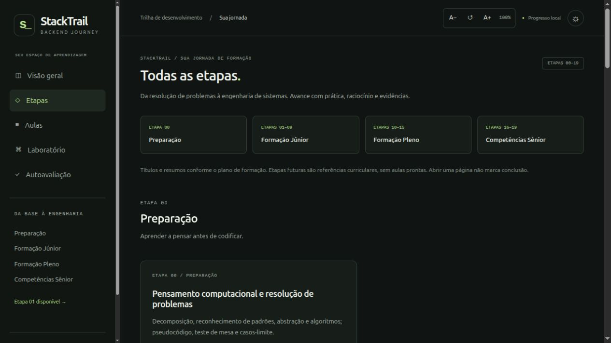

<h1 align="center">StackTrail</h1>
<p align="center"><strong>Learn. Build. Evolve.</strong></p>
<p align="center">Uma jornada de programação: aprenda conceitos, construa soluções e acompanhe sua evolução.<br>Formação inicial em desenvolvimento backend.</p>

<p align="center">
  
  
  
  
</p>

<p align="center">
  <a href="https://github.com/daniel0052/stacktrail">Repositório</a> ·
  <a href="#demonstracao">Demonstração</a> ·
  <a href="#instalacao-e-execucao">Executar localmente</a>
</p>

## Sobre o StackTrail

StackTrail é uma plataforma educacional voltada ao aprendizado progressivo de programação, inicialmente focada em desenvolvimento backend. Reúne aulas didáticas, exercícios e acompanhamento de progresso em um único ambiente, reduzindo a necessidade de alternar entre materiais dispersos.

A jornada combina conceitos, resolução de problemas e aprendizagem prática. O estudante deve conseguir explicar suas decisões e demonstrar suas soluções com evidências, usando a IA como apoio ao raciocínio e à revisão.

**Disponível agora:** Etapa 01 — Frontend para Backend, com **11 aulas e nove exercícios**. O mapa apresenta as etapas 00–19; as demais estão **em preparação**.

## Aviso sobre o conteúdo educacional

> [!IMPORTANT]
> O conteúdo didático do StackTrail é produzido integralmente com auxílio de inteligência artificial e pode conter erros conceituais, técnicos, exemplos incorretos ou informações desatualizadas.
>
> Embora o projeto busque oferecer materiais organizados e úteis para o aprendizado, não há garantia de precisão ou atualização de todas as informações.
>
> Recomenda-se conferir conceitos na documentação oficial das tecnologias, executar os exemplos e validar as soluções de forma independente.
>
> O StackTrail é uma ferramenta complementar de estudo e não substitui documentação oficial, orientação profissional ou experiência prática.

## Funcionalidades

| Recurso disponível | Como ajuda no estudo |
| --- | --- |
| **Roadmap interativo** | Curvas, marcadores e navegação entre quatro fases; etapas futuras identificadas. |
| **Aulas didáticas** | 11 aulas com objetivos, exemplos comentados, erros comuns, atividades e revisão. |
| **Laboratório** | Nove desafios em três níveis, com enunciados, requisitos e critérios de aceitação. |
| **Dicas graduais** | Três pistas por exercício, reveladas uma por vez. |
| **Registro de soluções** | Espaço para código/texto, reflexões e checklist de autoavaliação. |
| **Acompanhamento de progresso** | Estados de exercício, leitura de aulas, persistência local e exportação/importação de JSON. |
| **Ajuste de fonte** | Texto entre 90% e 150%, com restauração do padrão. |
| **Cópia de código** | Exemplos copiados com indentação e quebras de linha preservadas. |
| **Prompts para avaliação com IA** | Texto editável com enunciado, requisitos e critérios para revisão externa. |
| **Interface de estudo** | Layout responsivo, temas escuro/claro, foco visível, labels e atalho para o conteúdo. |

O progresso é local ao navegador, origem e dispositivo; não sincroniza automaticamente. Exportar um JSON permite fazer backup ou transferir os registros manualmente. O arquivo inclui soluções e reflexões, portanto não deve conter segredos ou dados pessoais.

A plataforma **não executa código colado nem corrige soluções automaticamente**. Marcar conclusão registra uma autoavaliação, não uma comprovação técnica.

## Tecnologias utilizadas

<table>
  <tr>
    <td align="center"><br><strong>React</strong></td>
    <td align="center"><br><strong>TypeScript</strong></td>
    <td align="center"><br><strong>Vite</strong></td>
  </tr>
  <tr>
    <td align="center"><br><strong>Tailwind CSS</strong></td>
    <td align="center"><br><strong>MDX</strong></td>
    <td align="center"><br><strong>React Router</strong></td>
  </tr>
</table>

| Tecnologia | Finalidade |
| --- | --- |
| React | Componentes e interação da interface. |
| TypeScript | Tipagem com `strict: true`, contratos e validação de dados externos. |
| Vite | Servidor de desenvolvimento e build estático. |
| Tailwind CSS | Utilitários de interface, combinados com estilos de tema e leitura. |
| MDX e `@mdx-js/rollup` | Aulas versionadas com componentes React reutilizáveis. |
| React Router | Navegação com HashRouter, compatível com hospedagem estática. |
| `rehype-highlight` | Realce de sintaxe dos exemplos durante o build. |
| `remark-gfm` | Suporte a tabelas e Markdown estendido nas aulas. |
| Vitest, Testing Library e jsdom | Testes de progresso, validação e interações. |
| ESLint e typescript-eslint | Análise estática do código. |

O realce de sintaxe usa `rehype-highlight`; Shiki não está instalado. Não há backend obrigatório, banco de dados, autenticação ou serviço de IA conectado.

## Jornada de aprendizagem

| Fase | Etapas | Objetivo |
| --- | --- | --- |
| Preparação | 00 | Fundamentos do raciocínio computacional. |
| Júnior | 01–09 | Fundamentos e desenvolvimento backend. |
| Pleno | 10–15 | Arquitetura, qualidade e sistemas robustos. |
| Sênior | 16–19 | Escalabilidade, confiabilidade e decisões técnicas. |

**Disponibilidade:** apenas a Etapa 01 tem aulas e exercícios. Etapa 00 e etapas 02–19 estão em preparação.

O conteúdo é disponibilizado progressivamente. Cards de etapas futuras mostram o escopo previsto, sem simular aulas prontas ou oferecer links para páginas vazias.

Na Etapa 01, HTML, CSS, TypeScript, DOM, assincronismo e comunicação navegador/API formam a base. Tailwind, React e Next.js são explorações opcionais.

A conclusão declarada exige os três exercícios iniciais, pelo menos um intermediário integrado e a autoavaliação de competências. Exercícios avançados e aulas opcionais não bloqueiam o avanço. Abrir uma página não marca uma etapa como concluída.

As referências externas das aulas e exercícios apontam para documentação técnica oficial. O conteúdo disponível é acessado por rotas internas do StackTrail.

<a name="demonstracao"></a>

## Demonstração

Captura real da listagem de etapas, registrada durante a validação local da plataforma:



A imagem mostra a interface implementada; não representa um deploy publicado.

<a name="instalacao-e-execucao"></a>

## Instalação e execução

### Pré-requisitos

- Node.js **24.15 ou superior**, conforme `package.json`.
- npm.

### Instalação e desenvolvimento

```bash
npm ci
npm run dev
```

Abra a URL informada pelo Vite, normalmente `http://127.0.0.1:5173/stacktrail/`. Se a porta estiver ocupada, o servidor informa outra. Use a mesma origem e porta para acessar o mesmo progresso local.

### Verificações e testes

```bash
npm run typecheck
npm run lint
npm run test
```

Para executar os testes em modo de observação:

```bash
npm run test:watch
```

### Build e prévia de produção

```bash
npm run build
npm run preview
```

O build é gerado em `dist/`. Abra a URL apresentada pela prévia, com o caminho `/stacktrail/`.

## Estrutura de pastas

```text
src/
  app/                    # mapa, etapas, aulas, autoavaliação e rotas
  components/
    learning/             # callouts, checkpoints, fonte e cópia de código
    lab/                  # laboratório, prompts e modal de revisão
  content/
    roadmap.ts            # metadados das etapas 00–19
    stage-01/
      lessons/            # aulas MDX
      exercises.ts        # nove exercícios estruturados
      index.ts            # sequência, rubrica e competências
      types.ts            # contrato e validação dos exercícios
  features/progress/      # persistência, migração e progresso da jornada
  styles/                 # Tailwind, temas e estilos de leitura
  tests/                  # testes automatizados
public/
  .nojekyll               # arquivo incluído no build para hospedagem estática
docs/                     # registros de desenvolvimento e validação
index.html
vite.config.ts
package.json
package-lock.json
AGENTS.md
README.md
```

Conteúdo, interface e persistência ficam separados. As aulas são carregadas sob demanda. Apenas MDX versionado no repositório é compilado; o código registrado pelo estudante permanece texto.

## Deploy

O destino de hospedagem estática configurado é **GitHub Pages**, como project site do repositório `daniel0052/stacktrail`.

- Vite utiliza `base: '/stacktrail/'` para os assets.
- HashRouter mantém as rotas após `#`, por exemplo `/stacktrail/#/aulas/html`.
- Ao atualizar uma aula diretamente, o servidor recebe `/stacktrail/`, sem depender de redirecionamento de rotas.
- `public/.nojekyll` é copiado para `dist/`.

A configuração atual prepara os arquivos para publicação, mas **não contém workflow de deploy nem script de publicação**. O processo disponível é gerar o build com `npm run build` e publicar o conteúdo de `dist/` pelo mecanismo de GitHub Pages escolhido pelo mantenedor. Não há comando automático de deploy neste repositório.

A base e a navegação foram verificadas em servidor estático local. Isso não comprova publicação no domínio real. Se for adotado um domínio personalizado ou um user site na raiz, ajuste a base do Vite antes de gerar o build.

## Inteligência artificial

A IA é uma ferramenta de apoio à aprendizagem e à revisão técnica. O botão **Avaliar com IA** gera um prompt com etapa, exercício, dificuldade, enunciado, requisitos, critérios e rubrica. O estudante revisa e copia o texto para a ferramenta de sua escolha, junto com sua solução e evidências.

Não existe integração direta com modelos de IA. Nenhum dado é enviado automaticamente e não há uso de API paga.

O projeto incentiva raciocínio e autonomia:

- Compreender a própria solução antes de pedir revisão.
- Pedir pistas graduais, em vez de uma implementação pronta.
- Exigir evidências para afirmações de funcionamento.
- Executar testes reais; a IA não substitui essa verificação.
- Identificar o que não pôde ser conferido e corrigir problemas observados.

Uma avaliação produzida por IA não garante funcionamento nem equivale a aprovação automática. A responsabilidade pela verificação continua com o estudante.

## Status do projeto

**Em desenvolvimento.** O mapa completo, o material da Etapa 01 e as ferramentas de estudo descritas acima estão implementados.

As aulas das outras etapas ainda não estão disponíveis. A expansão do conteúdo e os recursos adicionais de laboratório devem ser definidos após validar o padrão didático atual com estudantes.

Limites desta versão:

- Progresso local, sem conta ou sincronização.
- Autoavaliação sem avaliador técnico automático.
- Exemplos de endpoints são contratos didáticos; não há mock server HTTP incluído.
- Verificação de interface e teclado não equivale a uma auditoria completa WCAG ou de leitores de tela.

## Licença

Não existe arquivo `LICENSE` no repositório. A licença do projeto ainda não foi definida.
