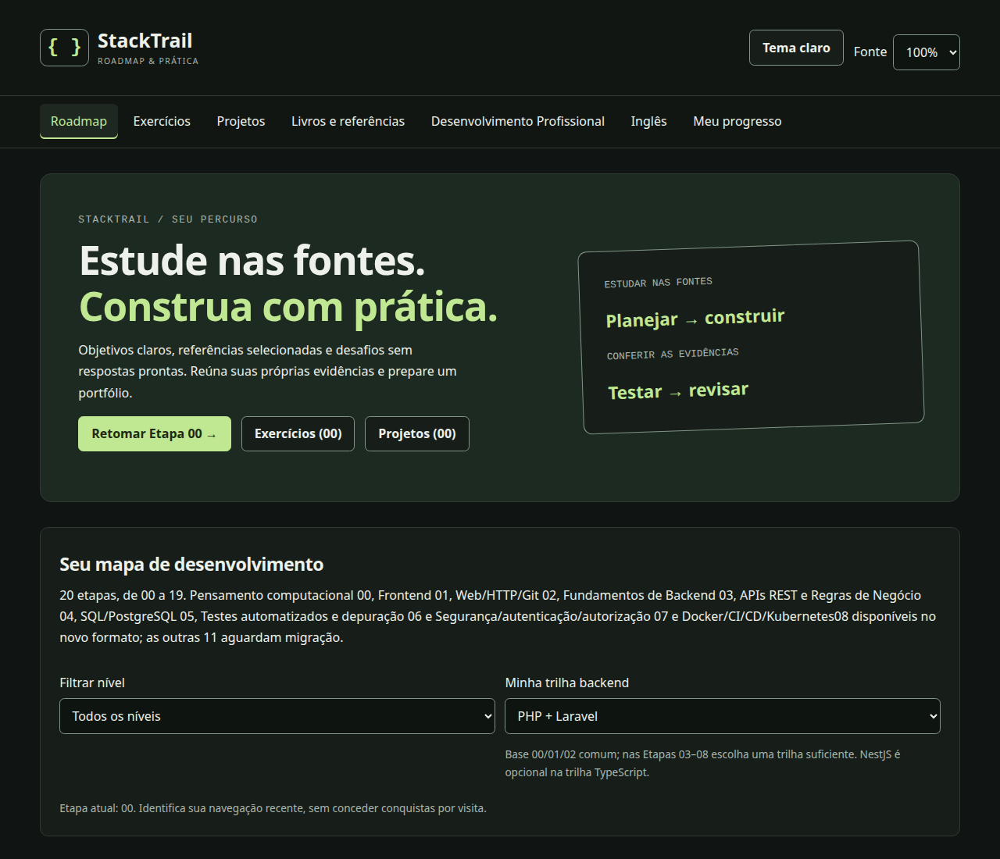
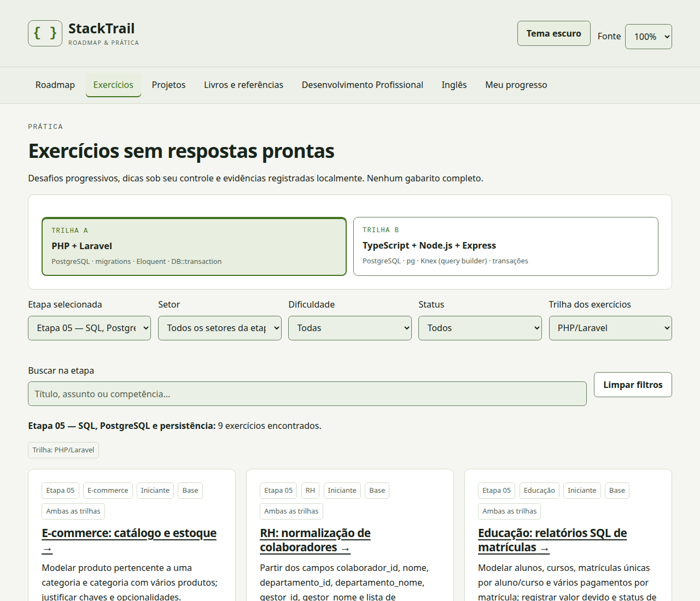
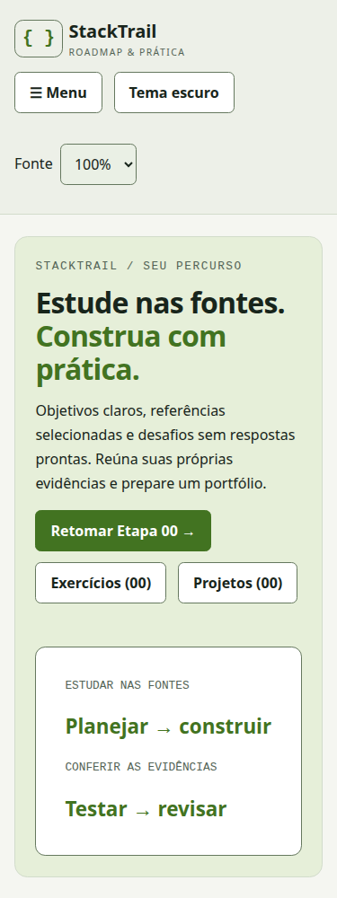

<p align="center">
  
</p>

<h1 align="center">StackTrail</h1>

<p align="center">
  <strong>Sua jornada de evolução na tecnologia.</strong><br>
  Aprenda, pratique e desenvolva habilidades para o mercado.
</p>

<p align="center">
  <a href="https://github.com/daniel0052/stacktrail/actions/workflows/ci.yml"></a>
  
  
</p>

<p align="center">
  <a href="https://daniel0052.github.io/stacktrail/">Acessar a plataforma</a> ·
  <a href="#começar-localmente">Executar localmente</a> ·
  <a href="#contribuir">Contribuir</a>
</p>

## Sobre o projeto

Estudar tecnologia envolve escolher o próximo assunto, encontrar boas fontes e transformar conhecimento em prática. O **StackTrail** reúne esse percurso em uma plataforma educacional em português brasileiro, com objetivos, referências e atividades organizados por etapa.

As fontes externas ensinam; o StackTrail ajuda você a planejar, praticar e acompanhar a própria jornada. Exercícios não incluem respostas prontas, e os projetos incentivam a construção de entregas que podem compor seu portfólio.

### Para quem é

- Estudantes que querem um caminho organizado para começar em desenvolvimento.
- Pessoas que estudam backend e procuram desafios para aplicar os fundamentos.
- Desenvolvedores que desejam revisar conhecimentos e registrar sua evolução.
- Colaboradores interessados em melhorar referências, acessibilidade e experiência de estudo.

## O que você encontra

| Recurso | Como ajuda |
| --- | --- |
| **Roadmap Backend** | Um mapa de 20 etapas, com objetivos, pré-requisitos e referências. As etapas 00–12 estão disponíveis no novo formato; 13–19 estão em preparação. |
| **Exercícios e projetos** | Atividades por etapa, dificuldade e trilha, dicas graduais e propostas para praticar em contextos variados. |
| **Biblioteca de referências** | Documentação, materiais externos e livros opcionais, com indicação de idioma e acesso e alternativas gratuitas. |
| **Meu progresso** | Registro de estudos e atividades, retomada de etapas e conquistas derivadas da sua autoavaliação. |
| **Engenharia com IA** | Três percursos independentes, com práticas, desafios finais, prompts editáveis e progresso local para usar IA com autonomia e verificação. |
| **Competências do Mercado** | Exploração de requisitos de anúncios públicos, filtros por perfil, fontes datadas e comparação de mercados com limitações explícitas. |
| **Ferramentas de Desenvolvimento com IA** | Planejamento de projetos por entrevista externa, árvores por plataforma, prompts de geração/revisão e progresso independente, para qualquer nível. |

Na prática de backend, você pode escolher **PHP + Laravel** ou **TypeScript + Node.js + Express**. São trilhas de aprendizagem, distintas das tecnologias usadas para construir o site.

Além do roadmap, explore [**Desenvolvimento Profissional**](https://daniel0052.github.io/stacktrail/#/desenvolvimento-profissional) e [**English Journey**](https://daniel0052.github.io/stacktrail/#/ingles), áreas complementares para sua evolução profissional e seus estudos de inglês.

## A plataforma em imagens

Capturas reais do build local, realizadas em 19/10/2026, com um perfil de demonstração sem dados pessoais.

### Roadmap



### Exercícios



<details>
<summary>Ver a experiência em uma tela mobile</summary>

<p align="center">
  
</p>

</details>

## Tecnologias

O frontend é uma aplicação estática construída com:

| | Tecnologia | Uso |
| --- | --- | --- |
|  | **React** | Componentes e interface |
|  | **TypeScript** | Tipagem do código e dos catálogos |
|  | **Vite** | Desenvolvimento e build |
|  | **Tailwind CSS** | Estilos, junto ao CSS e aos tokens do projeto |
|  | **React Router** | Navegação compatível com GitHub Pages |

Vitest, Testing Library, Playwright e ESLint apoiam os testes e a manutenção. Os [créditos dos ícones](docs/icons/LICENSE.md) estão preservados na documentação.

## Começar localmente

**Requisitos:** Node.js **24.15 ou superior**, npm e Git.

```bash
git clone https://github.com/daniel0052/stacktrail.git
cd stacktrail
npm ci
npm run dev
```

Abra o endereço informado pelo Vite, normalmente [localhost:5173/stacktrail/](http://localhost:5173/stacktrail/).

Para gerar a versão de produção e inspecioná-la localmente:

```bash
npm run build
npm run preview
```

Os comandos de teste, a organização do código e os detalhes do build estão no [guia de desenvolvimento](docs/DEVELOPMENT.md).

## Como usar

1. Acesse o [StackTrail](https://daniel0052.github.io/stacktrail/) e escolha uma etapa do roadmap.
2. Consulte os objetivos e as fontes indicadas; escolha sua trilha quando houver essa opção.
3. Pratique com os exercícios e projetos. Use os filtros para encontrar atividades e revele dicas quando precisar.
4. Registre o que estudou e concluiu. Em **Meu progresso**, retome suas atividades e acompanhe a evolução.

Seu progresso é salvo **neste navegador**, sem conta ou sincronização entre dispositivos. A plataforma não executa suas soluções nem oferece certificação; os registros são declarados por você. Veja os [detalhes sobre dados locais](docs/DEVELOPMENT.md#dados-e-limitações).

## Documentação

- [Índice da documentação](docs/README.md): guias, decisões e relatórios, com distinção entre material atual e histórico.
- [Desenvolvimento e operação](docs/DEVELOPMENT.md): ambiente, validação, arquitetura e compatibilidade.
- [Segurança](SECURITY.md): orientações para relatar problemas de segurança.

## Contribuir

Sugestões de referências, relatos de bugs e melhorias de interface são bem-vindos. Abra uma [issue](https://github.com/daniel0052/stacktrail/issues) descrevendo o problema ou a proposta. Para bugs, inclua a página, os passos para reproduzir e o comportamento esperado; evite expor dados pessoais.

Para enviar uma alteração, crie uma branch, mantenha o escopo claro e abra um [pull request](https://github.com/daniel0052/stacktrail/pulls) explicando o que mudou e como foi verificado. Consulte o [guia de desenvolvimento](docs/DEVELOPMENT.md) antes de começar. Preserve a proposta educacional: atividades orientam a prática sem publicar gabaritos.

## Licença e créditos

O repositório ainda não contém uma **licença geral do projeto**. As licenças e atribuições específicas de assets e materiais de terceiros estão registradas na documentação; elas não constituem uma licença para todo o StackTrail.
